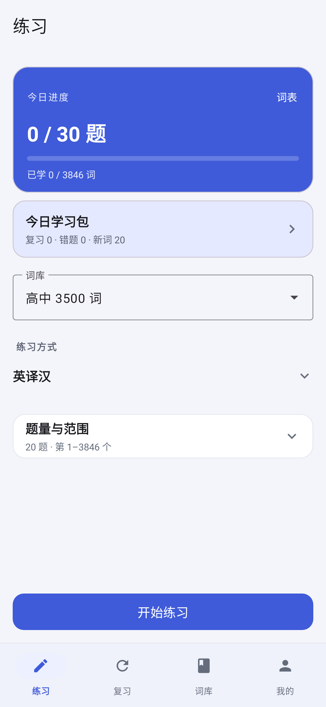
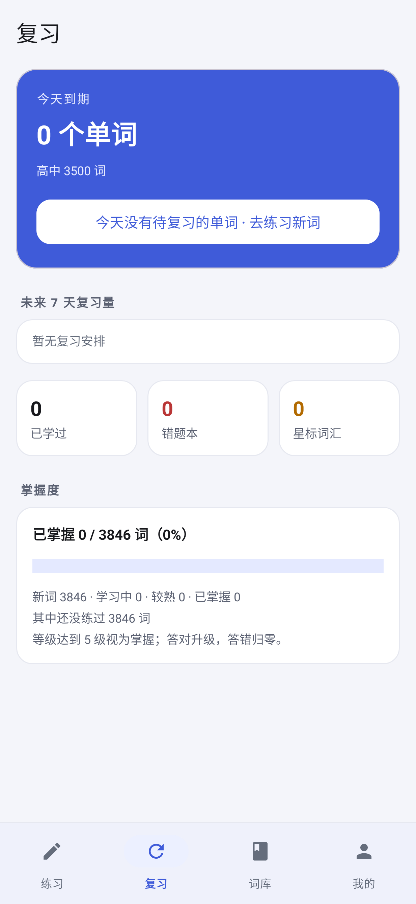
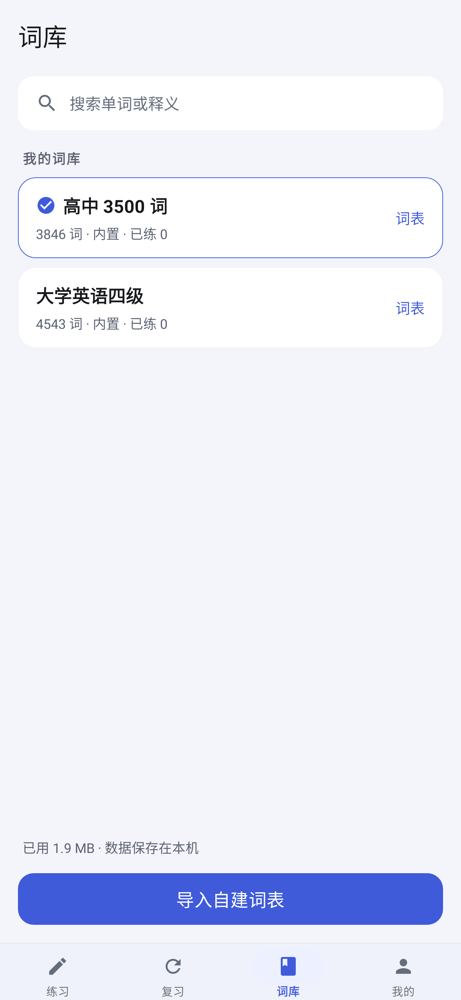
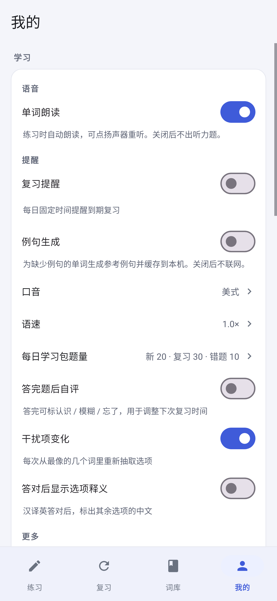
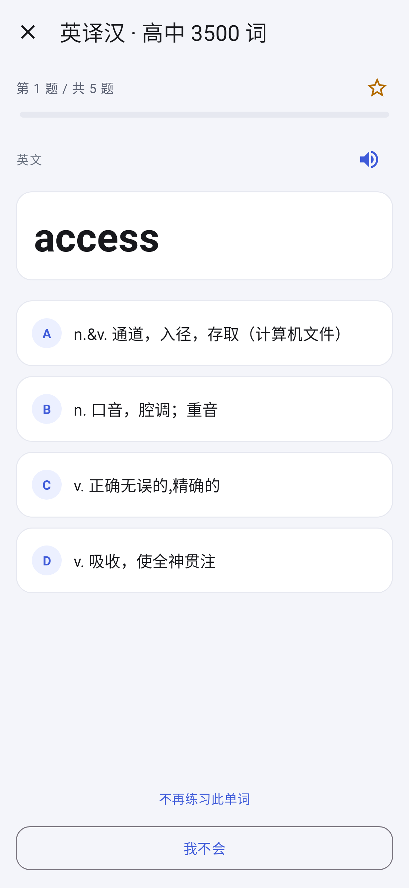
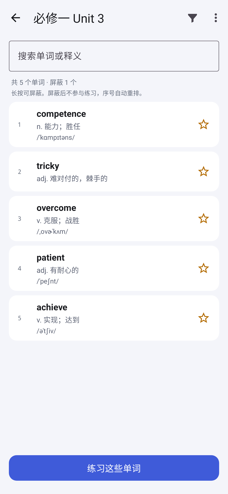
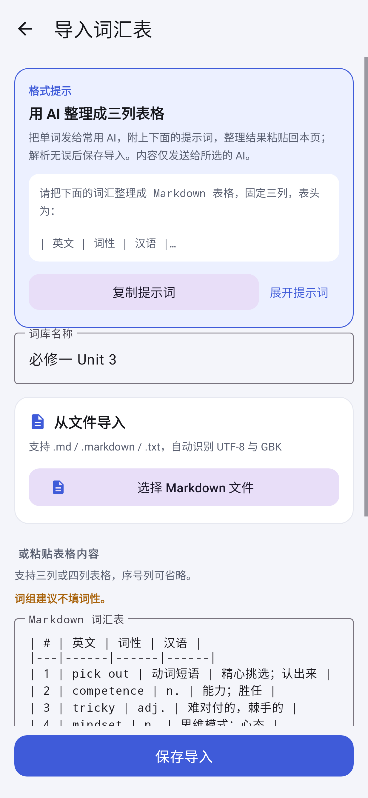
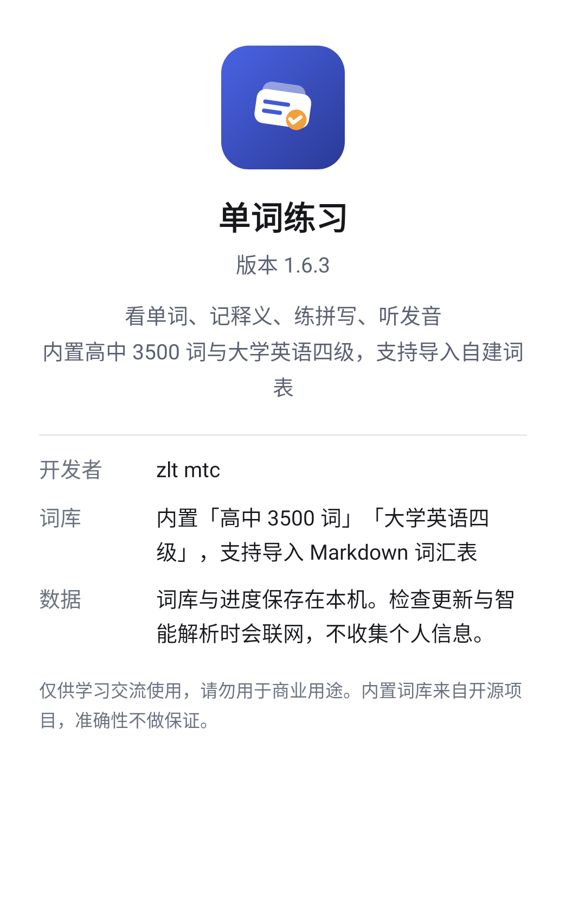

# 单词练习 WordDrill

Android 单词练习与复习 App：**英译汉 / 汉译英 / 单词默写 / 听音拼写 / 听音选义 / 例句填词 / 词形变化 / 混合**
八种题型，内置高中 3500 词与大学英语四级，也可以导入自己的词表。
无广告、无账号，词库、进度与复习排期全部保存在本机；只有「检查更新」「下载更新包」「AI 智能解析」「AI 例句生成」会联网，
后两者可关闭，关闭时 App 完全离线可用。

**当前版本 1.6.4**（versionCode 25） · 隐私说明见 [PRIVACY.md](PRIVACY.md)

Kotlin · 原生 View · SQLite · Material 3 · minSdk 24 / targetSdk 36

早期 1.0 的网页版仍可访问，仅作演示：<https://wordrill.zzlltt.xyz/>

## 截图

| 练习 | 复习 |
|---|---|
|  |  |

| 词库 | 我的 |
|---|---|
|  |  |

| 英译汉 | 单词默写 |
|---|---|
|  |  |

| 练习结果 | 词表 |
|---|---|
|  |  |

| 导入词汇表 | 关于 |
|---|---|
|  |  |

> 截图由 CI 里的 Robolectric 原生渲染生成，与真机显示基本一致；每次发版时重新生成并随仓库更新。

## 功能

### 练习

- **八种题型**：英译汉、汉译英、单词默写、听音拼写、听音选义、例句填词（给中文句意 + 挖空例句）、词形变化（过去式 / 常见不规则复数）、混合。
- **混合题型**：一轮里混着出，每道题的题型按单词 id 固定分配；关掉发音时不会出听力题，没有例句或词形的词会自动退出对应题型。
- **每日学习包**：把「到期复习 + 错题 + 新词」合成一轮，三类各自配额（默认 20 / 30 / 10），点一下直接开练。
- **开练即出题**：点「开始」先算前几题，剩下的在后台边答边算，不用等整轮算完；答题比后台快时会显示「正在准备下一题…」。
- **干扰项**：优先挑形近、义近的词当干扰项，且不会把同一词的近义写法当成错误选项；「干扰项变化」打开后每次重新抽。
- **三档自评**：答完题可选「认识 / 模糊 / 忘了」，直接决定下次复习时间；默认关闭，在「我的」里打开。
- **拼写诊断**：拼错时指出差几个字母、少了哪一段，以及有没有把 ie/ei、-tion/-sion、双写字母记混。
- **「我不会」与「不再练习此单词」**：答错自动进错题本；首练的词可以一次标成「已掌握」，之后不再抽到（词表里可恢复）。
- **手势**：长按加星；3 秒内答对记为「秒答」。（早期的左滑「我不会」已移除——不可见、无法撤销，误触一次就会改掉复习等级。）

### 词典与发音

- **音标**：内置美式 / 英式两套 IPA，高中词库覆盖约 92%、四级约 90%；练习反馈卡、词表、词典详情都会显示，口音在「我的」里切换。
- **双语例句**：内置例句覆盖约 91%，没有例句的词仍可手动生成（见「AI 例句生成」）。
- **固定搭配**：高中词库约八成词条带一条高频搭配，答题反馈里顺手看一眼。
- **易混词**：词典详情里列出拼写相近的词（adapt / adopt / adept），点进详情就能对比。
- **发音**：系统 TTS，全离线；可切美式 / 英式口音与三档语速。

### 复习与统计

- **间隔重复 + SM-2**：在 1 → 2 → 4 → 7 → 15 → 30 → 60 天的基础上引入难度系数 `ease`，认识拉长、模糊和忘了缩短；默认 ease 下曲线与旧版一致，升级后到期时间不会乱跳。
- **掌握度**：百分比进度条之外，还有一条横置的四段堆叠条（新词 / 学习中 / 较熟 / 已掌握）。
- **到期量折线**：未来 7 天的复习任务用折线画出来，比柱状更容易看出堆积。
- **一年打卡热力图**：按天着色，5 档强度。
- **分题型正确率**：报告页显示最近 30 天各题型的正确率与平均用时。
- **成就徽章**：8 枚里程碑（首个词、100/500 词、连续 3/7/30 天、掌握 50 词、秒答 20 题），答完题静默判定，只解锁一次；「我的 → 成就徽章」是一张独立页面，每枚徽章一个手绘图标，没解锁的整行压灰。
- **词汇量自测**：按词库前 / 中 / 后三段各抽 10 个词自评，按认识率外推词汇量。
- **考试倒计时**：填考试名和日期，练习页会按剩余未练词数反推每天该练多少。
- **打卡分享图**：报告页可生成 1080×1080 的打卡图，走系统分享。
- **每日一词组**：桌面小组件按日期取词，一天之内不换，跨天自动换，附带音标和一条搭配。

### 数据与备份

- **备份与恢复**：导出单个 JSON（自组词库、错题、星标、已掌握、打卡、练习进度、复习排期、音标与搭配）；普通导入与现有数据**合并**，不覆盖已有内容。
- **自动备份**：定时存快照，可设间隔与保留份数，支持手动快照与「清除备份缓存」；从自动备份恢复是**覆盖式**，会先把结果说清楚再动手。
- **错题导出 CSV**：词表页可把当前筛选结果导成 CSV，列有两种语言方向可选，方便贴进表格复习。
- **主题**：跟随系统 / 浅色 / 深色三态，重启后保持。
- **已掌握**：首练时可以就地标成已掌握，词表里能筛出来并恢复。

### 其他

- **每日复习提醒**：到点提醒你复习今天到期的单词，点通知直接开练；时间可自定，权限被拒时会说明原因。
- **已学过**：单独一页看当前词库练过的词，可按「还没掌握 / 已掌握 / 易忘」筛选，行内显示练过几次和下次复习时间。
- **生词本筛选**：可按首字母区间、词性、熟练度再筛一遍。
- **快捷方式**：长按桌面图标可直接进「今日复习」「词典」「学习报告」。
- **词典**：中英文双向模糊搜索，可一键发音或直接练这个词。
- **底部导航**：界面分成「练习 / 复习 / 词库 / 我的」四个页签，切页签保留各自的滚动位置和输入。
- **抽题设置**：每轮 1–200 题，可按词库索引区间抽题，可开关「允许重复抽到已练过的词」。
- **内置词库**：高中 3500 词（3846 条）+ 大学英语四级（4543 条），含词性、释义、音标、例句与搭配；默认使用高中 3500 词。
- **自组词库**：直接选择 Markdown 文件导入（自动识别 UTF-8 / GBK），也可粘贴表格；导入时可从系统分享或「用其他应用打开」直接把文本送到导入页，导入后还能继续追加。
- **AI 智能解析**：导入页可把随便一段文字（单词列表、CSV、OCR 结果、带音标的词汇表）交给自建 AI 服务整理成标准词表。
  服务端主地址是腾讯云 EdgeOne 边缘函数（`edgeone/smart-parse.js`，回退到 `netlify/functions/smart-parse.js`），背后接商汤日日新；
  密钥只放在服务端，客户端不需要 Key。接口文档见 [docs/smart-parse-api.md](docs/smart-parse-api.md)。
- **屏蔽单词**：长按词表中的单词即可屏蔽，被屏蔽的词不参与抽题，剩余单词索引自动重排，可随时恢复。
- **星标与错题**：练习页、词表都能加星标；答错自动进错题本，**连续答对 2 次**才移出；错题本支持搜索、按「最近错 / 错得最多 / 最该复习」排序、长按手动移出。
- **应用内更新**：启动时自动检查（6 小时一次），有新版可在应用内下载并安装；更新清单有 Gitee 与 Cloudflare Pages 两个源，取版本号更高的那份，避免 CDN 缓存旧清单导致误判「已是最新」。

## 构建

需要 JDK 17+ 与 Android SDK（platform 36）。CI 用的是 JDK 21。

```bash
git clone https://github.com/SpeakerC/worddrill.git
cd worddrill
./gradlew assembleDebug        # Windows 用 gradlew.bat assembleDebug

adb install -r app/build/outputs/apk/debug/app-debug.apk
```

APK 也可以直接从 [GitHub Releases](https://github.com/SpeakerC/worddrill/releases)
或 [Gitee Releases](https://gitee.com/MTeaCase/worddrill/releases) 下载（更新清单指向 Gitee 的下载地址）。

## 测试

```bash
./gradlew testDebugUnitTest
```

单元测试覆盖：出题逻辑与选项去重、SQLite 数据层（Robolectric 实际运行）、Markdown 词表解析与编码识别、
间隔重复曲线、复习队列、词典搜索、每日统计、备份合并、更新清单解析、智能解析返回值清洗、界面渲染与整页截图。

## 隐私

- 不注册、不收集个人信息；词库、错题、打卡、进度只存在本机，卸载即删除
- 联网只有四处：检查更新、下载更新包、你主动使用的「AI 智能解析」、你手动开启的「AI 例句生成」
- AI 解析只在你点击并确认后发送当次文本，服务端不保存；不用它时 App 完全离线可用
- 权限只有 `INTERNET`、`REQUEST_INSTALL_PACKAGES`（应用内安装更新）与 `POST_NOTIFICATIONS`（本地复习提醒）；
  没有存储、位置、相机、通讯录权限

完整说明（含第三方服务、代码审计入口）见 **[PRIVACY.md](PRIVACY.md)**。

## 协议

本项目以 [GNU General Public License v3.0](LICENSE) 发布，Copyright (C) 2026 2816 。

发布出去的 APK 对应的完整源代码即本仓库，可按 GPLv3 自由使用、修改、再分发。

内置词库来自 [pluto0x0/word3500](https://github.com/pluto0x0/word3500)（MIT；MIT 与 GPLv3 兼容）
与 [KyleBing/english-vocabulary](https://github.com/KyleBing/english-vocabulary)（BSD 3-Clause；同样与 GPLv3 兼容），
第三方组件与数据说明见 [THIRD-PARTY-NOTICES.md](THIRD-PARTY-NOTICES.md)。