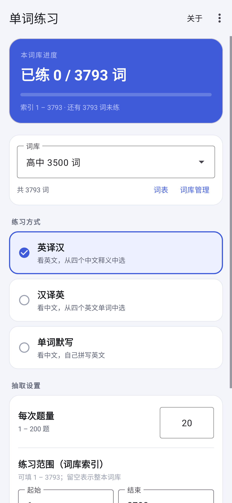
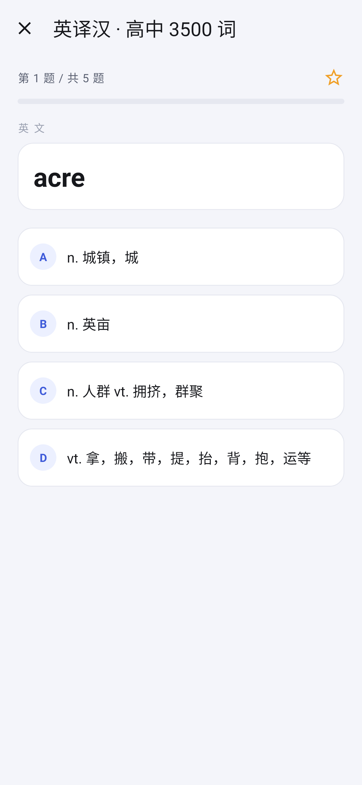
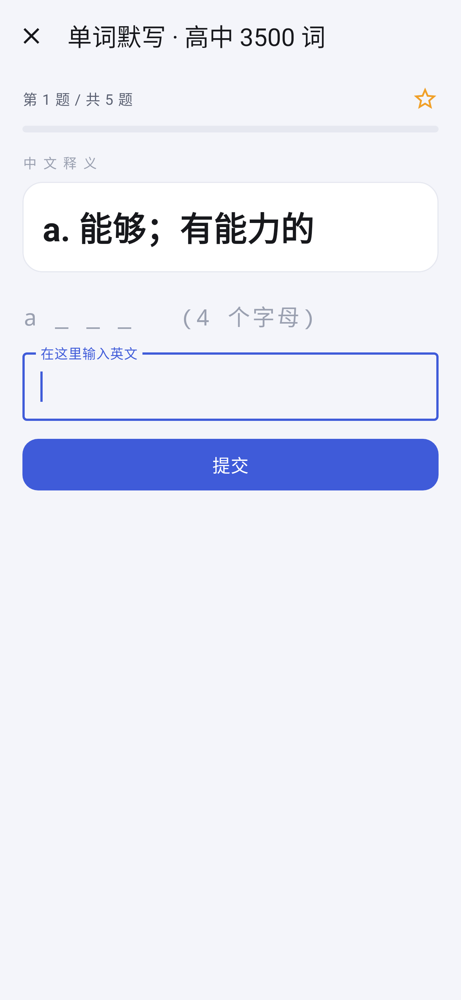
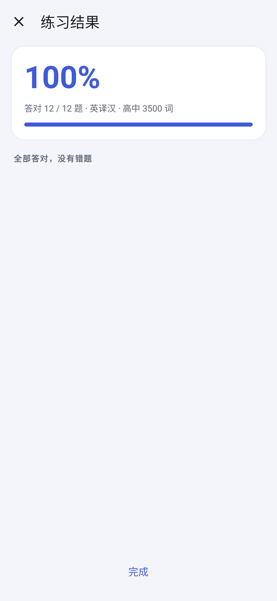
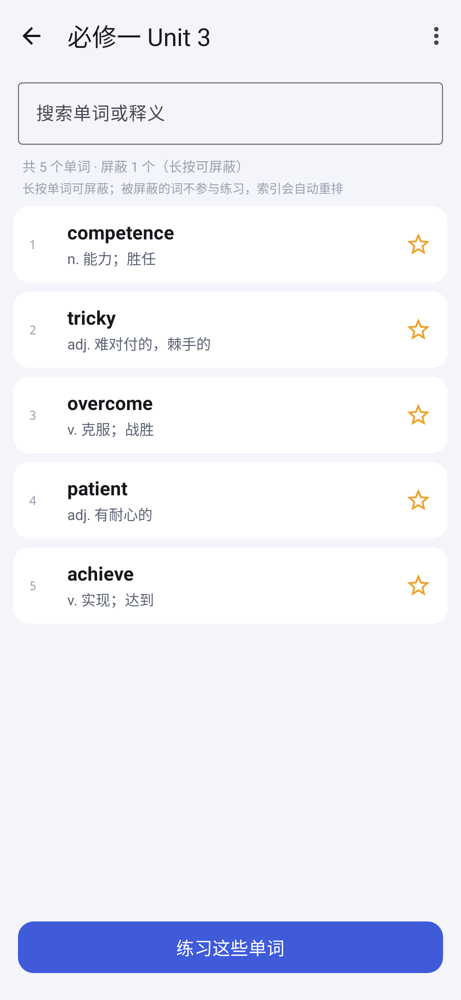
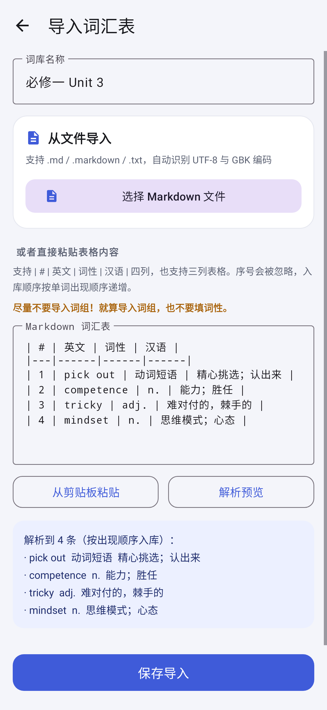

# 单词练习 WordDrill

Android 单词练习 App：**英译汉 / 汉译英 / 单词默写**三种模式，内置高中 3500 词，也可以导入自己的词汇表。
纯离线、无广告、无联网权限，数据全部保存在本机。

Kotlin · 原生 View · SQLite · Material 3 · minSdk 24 / targetSdk 36

## 截图

| 首页 | 英译汉 |
|---|---|
|  |  |

| 单词默写 | 练习结果 |
|---|---|
|  |  |

| 词表 | 导入词汇表 |
|---|---|
|  |  |

> 截图由 Robolectric 原生渲染生成，与真机显示基本一致。

## 功能

- **三种模式**：英译汉（看词选义）、汉译英（看义选词）、单词默写（看义拼写，带首字母与字母数提示）。
- **抽题设置**：每轮 1–200 题，可按词库索引区间抽题，可开关「允许重复抽到已练过的词」。
- **内置词库**：高中 3500 词，3793 条，含词性与释义。
- **自组词库**：直接选择 Markdown 文件导入（自动识别 UTF-8 / GBK），也可粘贴表格；导入后可继续追加单词。
- **屏蔽单词**：长按词表中的单词即可屏蔽，被屏蔽的词不参与抽题，剩余单词索引自动重排，可随时恢复。
- **星标与错题**：练习页、词表都能加星标；答错自动进错题本，答对自动移出，支持只练星标、重练错题。
- **练习进度**：首页显示当前词库的已练 / 总数与进度条。

## 构建

需要 JDK 17+ 与 Android SDK（platform 36）。

```bash
git clone https://github.com/SpeakerC/worddrill.git
cd worddrill
./gradlew assembleDebug        # Windows 用 gradlew.bat assembleDebug

adb install -r app/build/outputs/apk/debug/app-debug.apk
```

APK 也可以直接从 [Releases](https://github.com/SpeakerC/worddrill/releases) 下载。

## 测试

```bash
./gradlew testDebugUnitTest
```

43 个单元测试：出题逻辑、SQLite 数据层（Robolectric 实际运行）、Markdown 词表解析与编码识别、界面渲染。

## 协议

本项目以 [MIT 协议](LICENSE) 开源。

内置词库来自 [pluto0x0/word3500](https://github.com/pluto0x0/word3500)（MIT），第三方组件与数据说明见
[THIRD-PARTY-NOTICES.md](THIRD-PARTY-NOTICES.md)。
